# Ansatz


**[Try it live](https://ansatz-lab.vercel.app)** · **[The Moon’s gravity from Apollo 16 TV](https://ansatz-lab.vercel.app/x/moon-jump)** · **[Proof: the benchmark](https://ansatz-lab.vercel.app/proof)** · **[How it works](https://ansatz-lab.vercel.app/how)**

Ansatz turns a phone clip into a physics experiment. **SAM 3.1** measures the moving object in every frame, **Muse Spark** watches the clip, hears the narration (through **Muse Voice Transcribe**) and writes candidate laws of motion as equations, and code fits each law to the first 70% of the motion and makes it predict the last 30%. The law that predicts the frames it never saw wins. **Muse Wonder** writes one more law when the misses point to a missing effect. The result is a stroboscopic print made from SAM’s own masks, the law in LaTeX, every constant with an uncertainty, and a list of every model call and what it cost.

Built for the Meta Global AI Developer Hackathon (Indie track), themes *Push the Frontier* (accelerate a scientific experiment) and *Build for Your World* (a phone and a pile of books instead of a physics lab).

## What it measured

| | Ansatz | Truth |
|---|---|---|
| The Moon’s gravity, from John Young’s jump salute (Apollo 16 TV, 352×240, 1972) | **1.74 ± 0.12 m/s²** | 1.625 m/s² |
| 37 constants in rendered clips with known physics (g, string length, drag, restitution, damping, frequency, camera scale) | **median error 0.11%**, 36 of 37 within 5% | exact |
| The same constants read off the clips by Muse Spark alone | median error 26% | exact |
| A pendulum filmed in slow motion (no caption says so) | flagged: **4.2× slower than real life** | uploader titled it “slow motion” |

Full table, ablations and limits: [/proof](https://ansatz-lab.vercel.app/proof).

## How it works

```mermaid
flowchart LR
  A[Phone clip] --> B[ffmpeg: H.264, every frame's own timestamp, WAV]
  B --> C[Muse Voice Transcribe: narration]
  B --> D[Muse Spark 1.3: what moves, when, ruler, slow motion?]
  C --> D
  D --> E[SAM 3.1: masks in every frame]
  E --> F[Measure: sub-pixel centroids, scale, angle about a pivot]
  F --> G[Muse Spark 1.3: 2–4 candidate laws as ODEs]
  G --> H[Code: RK4 + Levenberg–Marquardt on first 70%]
  H --> I[Predict last 30%; simpler law wins ties]
  I --> J[Muse Spark referee; Muse Wonder writes one revision]
  J --> K[Report: strobe print, law, constants ± σ, clock check]
```



- **The model never decides the winner and never writes a number into the report.** Fitted values enter the referee’s text as placeholders that code fills; a finding that types its own digits is replaced.
- **Laws are data, not code.** Muse writes equations in a small expression language that Ansatz parses and compiles; unknown symbols are rejected before anything runs ([`lib/physics/expr.ts`](lib/physics/expr.ts)).
- **The clock comes from the file.** Frame times are read from the MP4 sample table, not assumed from a frame rate ([`lib/video.ts`](lib/video.ts)).
- **Given is separated from measured.** Every report lists what was assumed (a ruler, a stated length, Earth’s gravity) apart from what was measured; a ruler’s own uncertainty is carried into each constant by its power of metres.
- **The clock check.** When a ruler makes gravity a measurement, a gravity far from the planet’s says the clip isn’t real time: gravity scales with the square of time.

## Run it

```bash
npm install
echo "META_API_KEY=..." > .env.local
npm run dev            # http://localhost:3900
npm test               # physics core, RLE decoder, units
npx tsx scripts/run.ts path/to/clip.mp4 --ruler "A4 sheet=0.297"   # one experiment from the command line
npx tsx scripts/bench.ts --suite synth && npx tsx scripts/score.ts  # the benchmark
```

Production stores clips and experiments in Google Cloud Storage through Vercel’s OIDC token (no keys). Each run costs about $0.10–0.30 of Meta API calls; runs are capped per visitor and per day.

## Credits

Showcase clips: NASA Apollo 16 television (public domain), digitised by Ken Glover for the Apollo Lunar Surface Journal; “Blocked pendulum slow motion” by MikeRun, Wikimedia Commons, CC BY-SA 4.0. Rendered benchmark clips are made by this project.

MIT licence for the code.
