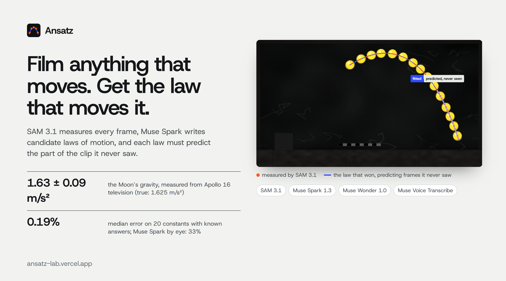

# Ansatz



**[Try it live](https://ansatz-lab.vercel.app)** · **[The demo, 2:58](https://youtu.be/M4h122br2qE)** · **[The Moon’s gravity from Apollo 16 TV](https://ansatz-lab.vercel.app/x/moon-jump)** · **[Proof: the benchmark](https://ansatz-lab.vercel.app/proof)** · **[How it works](https://ansatz-lab.vercel.app/how)**

**What it measured**

- Apollo 16 TV slowed 1.5× in secret: Muse Spark called it real speed 5 of 5 times; Ansatz measured **1.494 ± 0.015×**.
- 28 rendered clips with known physics: **26 of 27 constants within 5%** (median 0.11%); Muse Spark by eye: 32%.
- A stranger’s 50 cm pendulum (Aachen, CC BY-SA): **g = 9.82 ± 0.10 m/s²** vs 9.81. A museum film sped up 5×: read as **4.98 ± 0.02×**.
- Gravity is a clock: one known length turns gravity into a clock, so a g wrong by a square says the footage is not playing at life speed. From gravity alone, the slowed Apollo copy reads **1.50 ± 0.05×** slower and the museum film **4.98 ± 0.02×** faster. The home page lets you try the same six real clips blind first ([Can you tell?](https://ansatz-lab.vercel.app/#can-you-tell)).
- A hidden stiffening spring: Muse Wonder, an agent with a fitting tool, found the cubic law, **k₃/m = 4012 ± 17** vs 4000.

Ansatz turns a video of one moving object (a falling, swinging, bouncing or spring-driven thing) into a physics experiment, built so a phone propped on books can stand in for a school’s light gates. **SAM 3.1** measures the moving object frame by frame, up to 450 frames a run (its masks stream onto the clip as they arrive). **Muse Spark** watches the clip, hears the narration through **Muse Voice Transcribe**, and writes candidate laws of motion as equations. Code fits each law to the first 70% of the motion and makes it predict the last 30%; the law that best predicts the last 30%, which no law was fitted to, wins. Muse Spark watches the whole clip only to say what to track and when. The call that writes the laws never sees the video: it gets that description and the measurements, and code fits every constant on the first 70% alone, so the last 30% stays a true test. When every law misses, **Muse Wonder** works as an agent with a fitting tool: it tries laws on the seen frames (up to two fits in production) and submits one, which must win the same way. The result is a stroboscopic print made from SAM’s own masks, the law in LaTeX, every constant with an uncertainty, a lab report, the data as CSV, and every model call with what it cost.

Built for the Meta Global AI Developer Hackathon (Indie track), on the themes *Push the Frontier* (accelerate a scientific experiment) and *Build for Your World* (a phone and a pile of books instead of a physics lab). Everything here was built during the hackathon (Oct 26 to Nov 4, 2026).

**Who it is for.** Students doing the pendulum, free-fall and projectile practicals without light gates: film the motion, say the string's length, and get g, the law and the error against the textbook. Teachers: a class link gives every student's run on one page, with a grading sheet and a CSV. Anyone with a phone who needs a number from a video, or wants to know whether a clip runs at real time. No clip on the site was filmed on a phone yet, and no outside class has used it yet.

## Drag the line yourself

Every experiment opens on a **Falsification Plate**. The clip is printed as a cyanotype, SAM 3.1's measurements sit on it in orange, and a line splits the motion into the past the laws may see and the future they must predict. Drag the line from 30% to 90%: every candidate law is refitted on the past (precomputed at 13 positions by the same fitting code a run uses, [`scripts/falsify-grid.ts`](scripts/falsify-grid.ts)), its prediction of the future is drawn in white ink, and a law whose miss is far above the measurement noise is struck through in red. On the [stiffening spring](https://ansatz-lab.vercel.app/x/hardening-spring)'s published run, Muse Spark's laws are struck out at every position; Muse Wonder's survives (on a later re-run with today's prompt, Muse Spark proposed the cubic law itself; both pass the same held-out test).

The site is designed as a lab book ([`docs/DESIGN.md`](docs/DESIGN.md)): plates printed as cyanotypes after Anna Atkins' 1843 sun-prints, pages set in Computer Modern so the text and the equations share one face, a margin note beside every measured claim saying which model or code produced it, and an [architecture plate](https://ansatz-lab.vercel.app/judges#architecture) showing which model does what and the sealed last 30% that only code may touch.

## Can Muse Spark tell the speed on its own?

We slowed the 1972 Apollo 16 jump by 1.5× with motion-interpolated frames at an ordinary 29.97 fps, told no one, and asked Muse Spark about each clip on its own (up to 300 frames each, with the astronaut's height as a ruler): how fast does the astronaut fall as the video plays, and does it play at real speed?

| Clip | Muse Spark, one clip at a time | Ansatz, one clip at a time |
|---|---|---|
| Apollo 16, real speed | asked 5 times: “real speed, 1.6” 3 times, “slowed 2×, 0.4” twice | **1.72 ± 0.11 m/s²**: real speed (the Moon: 1.625) |
| The same clip, slowed 1.5× in secret | asked 5 times: “real speed, 1.6” every time (the textbook value) | **0.72 ± 0.04 m/s²**: slowed (the whole-clip estimate, which reads as 1.50×); the headline is measured jump for jump against the broadcast (jump windows set by hand), **1.494 ± 0.015×** (truth: 1.5×) |
| Three new renders, slowed 2×, 4×, 8× | g 9.8, 0.15, 9.8 | all three flagged by the clock check |

Asked about each clip on its own five times, the model called the slowed copy real speed every time, answering with the textbook 1.6. Side by side it can count frames and say B is about 1.5× slower, which is impressive; given Ansatz's measurements as tools it works out the whole-run ratio of the two accelerations, 1.55 ± 0.04× (the paired-ratio control: coarser than the headline, since it compares the two whole fits, not jump against jump), which needs no reference value. The headline is the jump-for-jump 1.494 ± 0.015×. Ansatz needs no second clip.

## What it measured

| | Ansatz | Truth |
|---|---|---|
| 27 physical constants in 28 rendered clips with known physics (g, string length, drag, restitution, damping, frequency) | **26 of 27 within 5%**, median error 0.11% | exact |
| 17 camera scales in the same clips (metres per pixel, from a fall or a ruler) | 16 of 17 within 5%, median 0.18% | exact |
| Clips rendered in slow motion (1.25×, 1.5×, 2×, 4×, 8×), not declared | **3 of 5 flagged** by the clock check, factor right on 2 of 5; missed 1.25×, could not check 1.5× (the 8× clip misread its 15 cm ruler as a metre stick) | exact |
| The same constants read off the clips by Muse Spark alone | median error 32%; on the slowed clips it answered Earth’s 9.81 | exact |
| A hidden stiffening spring (a render): Muse Wonder’s law on the published run, found in four fits with its tool (that run used an earlier setting; production now allows two fits) | k₃/m = **4012 ± 17** m⁻²s⁻², ω₀ = 7.747 rad/s | 4000, 7.746 |
| A spring slowed by dry friction (a render), re-run with today's pipeline: Muse Wonder’s law | friction **355 ± 23 px/s²**, or 0.430 ± 0.028 m/s² at the render's own scale (−4.5%); ω₀ = 10.0007 ± 0.0019 rad/s; it misses the unseen motion by 0.263 px, against 3.68 px for Muse Spark's best law (14×) | 372 px/s² (0.45 m/s²), 10 |
| Real footage: a museum's Foucault pendulum (Békéscsaba, 8.97 m, published with the film by Zátonyi Sándor (ifj.), FizFilm, CC BY 4.0), told only its length | g about **9.7 m/s²**: Muse Spark's plain pendulum law gives 9.70 ± 0.15. Muse Wonder's law, with the camera's perspective, wins on the unseen frames (17.6 px against 24.5 px), but still misses them by 74× the noise, so it carries no error bar | 9.81 |
| Real footage from a stranger: a 50 cm pendulum, grey bob on black (“Schwingung (Definition)”, Rhetos, Aachen, CC BY-SA 4.0), told only “the string is about fifty centimetres long” | g = **9.82 ± 0.10 m/s²** (0.16%, 0.2σ; the ± carries the stated length's uncertainty); clock check: real time. The film's own stopwatch, cropped out before the run, times a swing at about 1.42 s | 9.81; theory 1.418 s |
| The same film's stretch its maker sped up 5× (we cropped out the on-screen label); Muse Spark, watching, called it real time | flagged by the clock check: plays **4.98 ± 0.02× faster** than life | 5× |
| A pendulum posted online as slow motion (no caption in the frames says so) | no slowdown claimed: a re-run with today's stricter pipeline does not measure the string's length, because the clamp catches the string | the uploader titled it “slow motion” |

Full table, ablations and limits: [/proof](https://ansatz-lab.vercel.app/proof).

**Footage from strangers.** On Nov 2 we ran five clips that strangers filmed and published under free licences, told only what their makers stated. One was measured and published (the Aachen pendulum above). A 25 cm pendulum in a test rig gave g = 9.84 ± 0.17 m/s² (0.3%), but the simple-harmonic law misses the unseen swing by 15% of the motion, so the publish gate refused it: the number landed, the law did not earn it. A brass bob in front of a metre stick: Muse Spark picked the stick on its own, and a pendulum of 0.716 ± 0.072 m fits within the noise, but no length or period was published, so there is nothing to compare. A metronome and a gym ball were misses (below). Every row is on [/proof](https://ansatz-lab.vercel.app/proof#strangers).

**Where it fails.** A real classroom clip, a 0.5 m pendulum whose bob is a small dark lead weight against a dark green chalkboard (“Pendelgesetz (mit Rechnung)”, Rhetos, Mathe-AC Lernwerkstatt Aachen, Wikimedia Commons, CC BY-SA 4.0): SAM 3.1 could not hold the bob, and Ansatz reported no usable g. The same source's clip of a grey bob on black measured 9.82 ± 0.10 m/s²: the object has to stand out from what is behind it. A metronome at 96 beats a minute: no law in the library is a metronome, and the fit was refused (its period, measured offline, is 1.235 s against the dial's 1.25 s). A green gym ball filmed at 240 fps and stored at 50: SAM 3.1 held only part of it in a green-lit corridor, every scale was wrong, and two tries both called the clip real time (it plays 4.8× slower).

## How it works

```mermaid
flowchart LR
  A[Video clip] --> B[ffmpeg: H.264, every frame's own timestamp, WAV]
  B --> C[Muse Voice Transcribe: narration]
  B --> D[Muse Spark 1.3: what moves, when, ruler, slow motion?]
  C --> D
  D --> E[SAM 3.1: masks frame by frame, up to 450]
  E --> F[Measure: sub-pixel centroids, scale, angle about a pivot]
  F --> G[Muse Spark 1.3: 2–4 candidate laws as ODEs]
  G --> H[Code: RK4 + Levenberg–Marquardt on first 70%]
  H --> I[Predict last 30%; simpler law wins ties]
  I --> J[Muse Spark referee; Muse Wonder, an agent with a fit tool]
  J --> K[Report: strobe print, law, constants ± σ, clock check]
```



- **The model never decides the winner, and every measured number comes from the fit.** Fitted values enter the referee’s text as placeholders that code fills; a finding that types its own digits is replaced.
- **Laws are data, not code.** Muse writes equations in a small expression language that Ansatz parses and compiles; unknown symbols are rejected before anything runs ([`lib/physics/expr.ts`](lib/physics/expr.ts)).
- **The clock comes from the file.** Frame times are read from the MP4 sample table, not assumed from a frame rate ([`lib/video.ts`](lib/video.ts)).
- **Given is separated from measured.** Every report lists what was assumed (a ruler, a stated length, Earth’s gravity) apart from what was measured; a ruler’s own uncertainty is carried into each constant by its power of metres.
- **The clock check.** When a ruler makes gravity a measurement, a gravity far from the planet’s says the clip isn’t real time: gravity scales with the square of time.
- **Ranking is order-independent.** Each law is scored on the worse of its fitted and held-out errors, in units of measurement noise. Laws that both predict within the noise tie, and the simpler one wins. Model-guessed bounds that a fit presses against are widened and refitted from where the fit stopped.

## Run it

```bash
npm install
echo "META_API_KEY=..." > .env.local
npm run dev            # http://localhost:3900
npm test               # physics core, RLE decoder, units
npx tsx scripts/run.ts path/to/clip.mp4 --ruler "A4 sheet=0.297"   # one experiment from the command line
npx tsx scripts/bench.ts --suite synth && npx tsx scripts/score.ts  # the benchmark
```

Production stores clips and experiments in Google Cloud Storage through Vercel’s OIDC token (no keys). A published run costs a median of $0.23 of Meta API calls ($0.13–0.43; a class of 40 is about $9); runs are capped per visitor and per day.

## Credits

Type: Computer Modern (KaTeX fonts, SIL OFL) and Archivo (SIL OFL). Showcase clips: NASA Apollo 16 television (public domain), digitised by Ken Glover for the Apollo Lunar Surface Journal; “Blocked pendulum slow motion” by MikeRun, Wikimedia Commons, CC BY-SA 4.0; “Foucault pendulum in Békéscsaba” by Zátonyi Sándor (ifj.), FizFilm, Wikimedia Commons, CC BY 4.0 (cropped, and its 5× label cut out); “Pendelgesetz (mit Rechnung)” by Rhetos, Mathe-AC Lernwerkstatt Aachen, Wikimedia Commons, CC BY-SA 4.0. Footage from strangers, run on Nov 2: [“Schwingung (Definition)”](https://commons.wikimedia.org/wiki/File:Schwingung_(Definition).webm) by Rhetos, Mathe-AC Lernwerkstatt Aachen, CC BY-SA 4.0 (cropped; stopwatch and counter cut out); [“Flummiversuch (Gymnastikball-Rücksteighöhe)”](https://commons.wikimedia.org/wiki/File:Flummiversuch_(Gymnastikball-R%C3%BCcksteigh%C3%B6he).webm) by Rhetos, CC BY-SA 4.0; [“Pendulum in controlled gravity”](https://commons.wikimedia.org/wiki/File:Pendulum_in_controlled_gravity.ogv) by NS (Nikos.kse), CC BY-SA 4.0 (cropped); [“Metronome”](https://commons.wikimedia.org/wiki/File:Metronome.webm) by Daniel Eriksson (Belteshassar), CC BY 4.0; [a pendulum in front of a metre rule](https://www.youtube.com/watch?v=ZZBGxkgtXN8) by Lim Jit Ning, shared by Loo Kang Wee, YouTube, CC BY. Rendered benchmark clips are made by this project.

MIT licence for the code.
