# Ansatz


**[Try it live](https://ansatz-lab.vercel.app)** · **[The Moon’s gravity from Apollo 16 TV](https://ansatz-lab.vercel.app/x/moon-jump)** · **[Proof: the benchmark](https://ansatz-lab.vercel.app/proof)** · **[How it works](https://ansatz-lab.vercel.app/how)**

Ansatz turns a phone clip into a physics experiment. **SAM 3.1** measures the moving object in every frame (its masks stream onto the clip as they arrive). **Muse Spark** watches the clip, hears the narration through **Muse Voice Transcribe**, and writes candidate laws of motion as equations. Code fits each law to the first 70% of the motion and makes it predict the last 30%; the law that best predicts the frames it never saw wins. When every law misses, **Muse Wonder** works as an agent with a fitting tool: it tries laws on the seen frames and submits one, which must win the same way. The result is a stroboscopic print made from SAM’s own masks, the law in LaTeX, every constant with an uncertainty, a lab report, the data as CSV, and every model call with what it cost.

Built for the Meta Global AI Developer Hackathon (Indie track), on the themes *Push the Frontier* (accelerate a scientific experiment) and *Build for Your World* (a phone and a pile of books instead of a physics lab).

## Memory or measurement

Show Muse Spark every frame of the 1972 Apollo 16 clip and ask for the Moon’s gravity: it says 1.63. Slow the clip down 1.5× in secret and it still says 1.60: it recognises the footage and recalls the textbook. On the real clip the recalled value is closer to the truth; only the measurement responds to the slowdown. Ansatz measures:

| Clip | Muse Spark, by eye | Ansatz, measured |
|---|---|---|
| Apollo 16, John Young’s jump salute | 1.63 m/s² | **1.72 ± 0.11 m/s²** (the Moon: 1.625) |
| The same clip, slowed 1.5× in secret (motion-interpolated, 29.97 fps) | 1.60 m/s² | **0.72 ± 0.05 m/s²**, so the clip runs **1.55 ± 0.04× slow** (truth: 1.5×) |

## What it measured

| | Ansatz | Truth |
|---|---|---|
| 27 physical constants in 28 rendered clips with known physics (g, string length, drag, restitution, damping, frequency) | **26 of 27 within 5%**, median error 0.11% | exact |
| 17 camera scales in the same clips (metres per pixel, from a fall or a ruler) | 16 of 17 within 5%, median 0.21% | exact |
| Clips rendered in slow motion (2×, 4×, 8×), not declared | **all 3 flagged** by the clock check; factor within 2% on two (the third misread its 15 cm ruler as a metre stick) | exact |
| The same constants read off the clips by Muse Spark alone | median error 38%; on the slowed clips it answered Earth’s 9.81 | exact |
| A hidden stiffening spring (a render): Muse Wonder’s law, found with its fitting tool | k₃/m = **4012 ± 7** m⁻²s⁻², ω₀ = 7.747 rad/s | 4000, 7.746 |
| A pendulum filmed in slow motion (no caption says so) | flagged: about **4.3× slower than real life** | the uploader titled it “slow motion” |

Full table, ablations and limits: [/proof](https://ansatz-lab.vercel.app/proof).

## How it works

```mermaid
flowchart LR
  A[Phone clip] --> B[ffmpeg: H.264, every frame's own timestamp, WAV]
  B --> C[Muse Voice Transcribe: narration]
  B --> D[Muse Spark 1.3: what moves, when, ruler, slow motion?]
  C --> D
  D --> E[SAM 3.1: masks in every frame]
  E --> F[Measure: sub-pixel centroids, scale, angle about a pivot]
  F --> G[Muse Spark 1.3: 2–4 candidate laws as ODEs]
  G --> H[Code: RK4 + Levenberg–Marquardt on first 70%]
  H --> I[Predict last 30%; simpler law wins ties]
  I --> J[Muse Spark referee; Muse Wonder, an agent with a fit tool]
  J --> K[Report: strobe print, law, constants ± σ, clock check]
```



- **The model never decides the winner and never writes a number into the report.** Fitted values enter the referee’s text as placeholders that code fills; a finding that types its own digits is replaced.
- **Laws are data, not code.** Muse writes equations in a small expression language that Ansatz parses and compiles; unknown symbols are rejected before anything runs ([`lib/physics/expr.ts`](lib/physics/expr.ts)).
- **The clock comes from the file.** Frame times are read from the MP4 sample table, not assumed from a frame rate ([`lib/video.ts`](lib/video.ts)).
- **Given is separated from measured.** Every report lists what was assumed (a ruler, a stated length, Earth’s gravity) apart from what was measured; a ruler’s own uncertainty is carried into each constant by its power of metres.
- **The clock check.** When a ruler makes gravity a measurement, a gravity far from the planet’s says the clip isn’t real time: gravity scales with the square of time.
- **Ranking is order-independent.** Each law is scored on the worse of its fitted and held-out errors, in units of measurement noise. Laws that both predict within the noise tie, and the simpler one wins. Model-guessed bounds that a fit presses against are widened and refitted from where the fit stopped.

## Run it

```bash
npm install
echo "META_API_KEY=..." > .env.local
npm run dev            # http://localhost:3900
npm test               # physics core, RLE decoder, units
npx tsx scripts/run.ts path/to/clip.mp4 --ruler "A4 sheet=0.297"   # one experiment from the command line
npx tsx scripts/bench.ts --suite synth && npx tsx scripts/score.ts  # the benchmark
```

Production stores clips and experiments in Google Cloud Storage through Vercel’s OIDC token (no keys). Each run costs about $0.10–0.40 of Meta API calls (a class of 40 is about $8); runs are capped per visitor and per day.

## Credits

Showcase clips: NASA Apollo 16 television (public domain), digitised by Ken Glover for the Apollo Lunar Surface Journal; “Blocked pendulum slow motion” by MikeRun, Wikimedia Commons, CC BY-SA 4.0. Rendered benchmark clips are made by this project.

MIT licence for the code.
