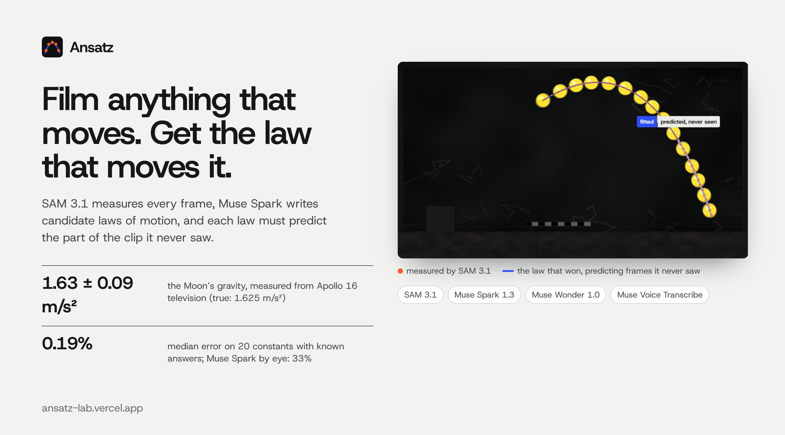

# Ansatz



**[Try it live](https://ansatz-lab.vercel.app)** · **[The demo, 2:20](https://youtu.be/NEy2kR944QY)** · **[The Moon’s gravity from Apollo 16 TV](https://ansatz-lab.vercel.app/x/moon-jump)** · **[Proof: the benchmark](https://ansatz-lab.vercel.app/proof)** · **[How it works](https://ansatz-lab.vercel.app/how)**

Ansatz turns a phone clip into a physics experiment. **SAM 3.1** measures the moving object in every frame (its masks stream onto the clip as they arrive). **Muse Spark** watches the clip, hears the narration through **Muse Voice Transcribe**, and writes candidate laws of motion as equations. Code fits each law to the first 70% of the motion and makes it predict the last 30%; the law that best predicts the last 30%, which no law was fitted to, wins. Muse Spark watches the whole clip to name what moves; no number from the last 30% reaches it, and no law is fitted to it. When every law misses, **Muse Wonder** works as an agent with a fitting tool: it tries laws on the seen frames and submits one, which must win the same way. The result is a stroboscopic print made from SAM’s own masks, the law in LaTeX, every constant with an uncertainty, a lab report, the data as CSV, and every model call with what it cost.

Built for the Meta Global AI Developer Hackathon (Indie track), on the themes *Push the Frontier* (accelerate a scientific experiment) and *Build for Your World* (a phone and a pile of books instead of a physics lab). Everything here was built during the hackathon (Oct 26 to Nov 4, 2026).

## Drag the line yourself

Every experiment opens on a **Falsification Plate**. The clip is printed as a cyanotype, SAM 3.1's measurements sit on it in orange, and a line splits the motion into the past the laws may see and the future they must predict. Drag the line from 30% to 90%: every candidate law is refitted on the past (precomputed at 13 positions by the same fitting code a run uses, [`scripts/falsify-grid.ts`](scripts/falsify-grid.ts)), its prediction of the future is drawn in white ink, and a law whose miss is far above the measurement noise is struck through in red. On the [stiffening spring](https://ansatz-lab.vercel.app/x/hardening-spring)'s published run, Muse Spark's laws are struck out at every position; Muse Wonder's survives (on a later re-run with today's prompt, Muse Spark proposed the cubic law itself; both pass the same held-out test).

The site is designed as a lab book ([`docs/DESIGN.md`](docs/DESIGN.md)): plates printed as cyanotypes after Anna Atkins' 1843 sun-prints, pages set in Computer Modern so the text and the equations share one face, a margin note beside every measured claim saying which model or code produced it, and an [architecture plate](https://ansatz-lab.vercel.app/judges#architecture) showing which model does what and the sealed last 30% that only code may touch.

## Can Muse Spark tell the speed on its own?

We slowed the 1972 Apollo 16 jump by 1.5× with motion-interpolated frames at an ordinary 29.97 fps, told no one, and asked Muse Spark about each clip on its own (up to 300 frames each, with the astronaut's height as a ruler): how fast does the astronaut fall as the video plays, and does it play at real speed?

| Clip | Muse Spark, one clip at a time | Ansatz, one clip at a time |
|---|---|---|
| Apollo 16, real speed | asked 5 times: “real speed, 1.6” 3 times, “slowed 2×, 0.4” twice | **1.72 ± 0.11 m/s²**: real speed (the Moon: 1.625) |
| The same clip, slowed 1.5× in secret | asked 5 times: “real speed, 1.6” every time (the textbook value) | **0.72 ± 0.05 m/s²**: slowed; measured jump for jump against the broadcast, **1.494 ± 0.015×** (truth: 1.5×) |
| Three new renders, slowed 2×, 4×, 8× | g 9.8, 0.15, 9.8 | all three flagged by the clock check |

Asked about each clip on its own five times, the model called the slowed copy real speed every time, answering with the textbook 1.6. Side by side it can count frames and say B is about 1.5× slower, which is impressive; given Ansatz's measurements as tools it works out the whole-run ratio of the two accelerations, 1.55 ± 0.04×, which needs no reference value. Ansatz needs no second clip.

## What it measured

| | Ansatz | Truth |
|---|---|---|
| 27 physical constants in 28 rendered clips with known physics (g, string length, drag, restitution, damping, frequency) | **26 of 27 within 5%**, median error 0.11% | exact |
| 17 camera scales in the same clips (metres per pixel, from a fall or a ruler) | 16 of 17 within 5%, median 0.18% | exact |
| Clips rendered in slow motion (1.25×, 1.5×, 2×, 4×, 8×), not declared | **3 of 5 flagged** by the clock check, factor right on 2 of 5; missed 1.25×, could not check 1.5× (the 8× clip misread its 15 cm ruler as a metre stick) | exact |
| The same constants read off the clips by Muse Spark alone | median error 32%; on the slowed clips it answered Earth’s 9.81 | exact |
| A hidden stiffening spring (a render): Muse Wonder’s law on the published run, found with its fitting tool | k₃/m = **4012 ± 17** m⁻²s⁻², ω₀ = 7.747 rad/s | 4000, 7.746 |
| A spring slowed by dry friction (a render): Muse Wonder’s law, after widening a bound it had first set too tight | friction 363 ± 5 px/s², ω₀ = 10.000 rad/s; the best of 12 textbook laws misses the unseen motion 33× worse | 372, 10 |
| A pendulum filmed in slow motion (no caption says so) | flagged: about **4 to 4.5× slower than real life** (unconfirmed: the capture rate isn’t published) | the uploader titled it “slow motion” |

Full table, ablations and limits: [/proof](https://ansatz-lab.vercel.app/proof).

**Where it fails.** A real classroom clip, a 0.5 m pendulum whose bob is a small dark lead weight against a dark green chalkboard (“Pendelgesetz (mit Rechnung)”, Rhetos, Mathe-AC Lernwerkstatt Aachen, Wikimedia Commons, CC BY-SA 4.0): SAM 3.1 could not hold the bob, and Ansatz reported no usable g. The object has to stand out from what is behind it.

## How it works

```mermaid
flowchart LR
  A[Phone clip] --> B[ffmpeg: H.264, every frame's own timestamp, WAV]
  B --> C[Muse Voice Transcribe: narration]
  B --> D[Muse Spark 1.3: what moves, when, ruler, slow motion?]
  C --> D
  D --> E[SAM 3.1: masks in every frame]
  E --> F[Measure: sub-pixel centroids, scale, angle about a pivot]
  F --> G[Muse Spark 1.3: 2–4 candidate laws as ODEs]
  G --> H[Code: RK4 + Levenberg–Marquardt on first 70%]
  H --> I[Predict last 30%; simpler law wins ties]
  I --> J[Muse Spark referee; Muse Wonder, an agent with a fit tool]
  J --> K[Report: strobe print, law, constants ± σ, clock check]
```



- **The model never decides the winner, and every measured number comes from the fit.** Fitted values enter the referee’s text as placeholders that code fills; a finding that types its own digits is replaced.
- **Laws are data, not code.** Muse writes equations in a small expression language that Ansatz parses and compiles; unknown symbols are rejected before anything runs ([`lib/physics/expr.ts`](lib/physics/expr.ts)).
- **The clock comes from the file.** Frame times are read from the MP4 sample table, not assumed from a frame rate ([`lib/video.ts`](lib/video.ts)).
- **Given is separated from measured.** Every report lists what was assumed (a ruler, a stated length, Earth’s gravity) apart from what was measured; a ruler’s own uncertainty is carried into each constant by its power of metres.
- **The clock check.** When a ruler makes gravity a measurement, a gravity far from the planet’s says the clip isn’t real time: gravity scales with the square of time.
- **Ranking is order-independent.** Each law is scored on the worse of its fitted and held-out errors, in units of measurement noise. Laws that both predict within the noise tie, and the simpler one wins. Model-guessed bounds that a fit presses against are widened and refitted from where the fit stopped.

## Run it

```bash
npm install
echo "META_API_KEY=..." > .env.local
npm run dev            # http://localhost:3900
npm test               # physics core, RLE decoder, units
npx tsx scripts/run.ts path/to/clip.mp4 --ruler "A4 sheet=0.297"   # one experiment from the command line
npx tsx scripts/bench.ts --suite synth && npx tsx scripts/score.ts  # the benchmark
```

Production stores clips and experiments in Google Cloud Storage through Vercel’s OIDC token (no keys). Each run costs about $0.10–0.40 of Meta API calls (a class of 40 is about $8); runs are capped per visitor and per day.

## Credits

Type: Computer Modern (KaTeX fonts, SIL OFL) and Archivo (SIL OFL). Showcase clips: NASA Apollo 16 television (public domain), digitised by Ken Glover for the Apollo Lunar Surface Journal; “Blocked pendulum slow motion” by MikeRun, Wikimedia Commons, CC BY-SA 4.0. Rendered benchmark clips are made by this project.

MIT licence for the code.
